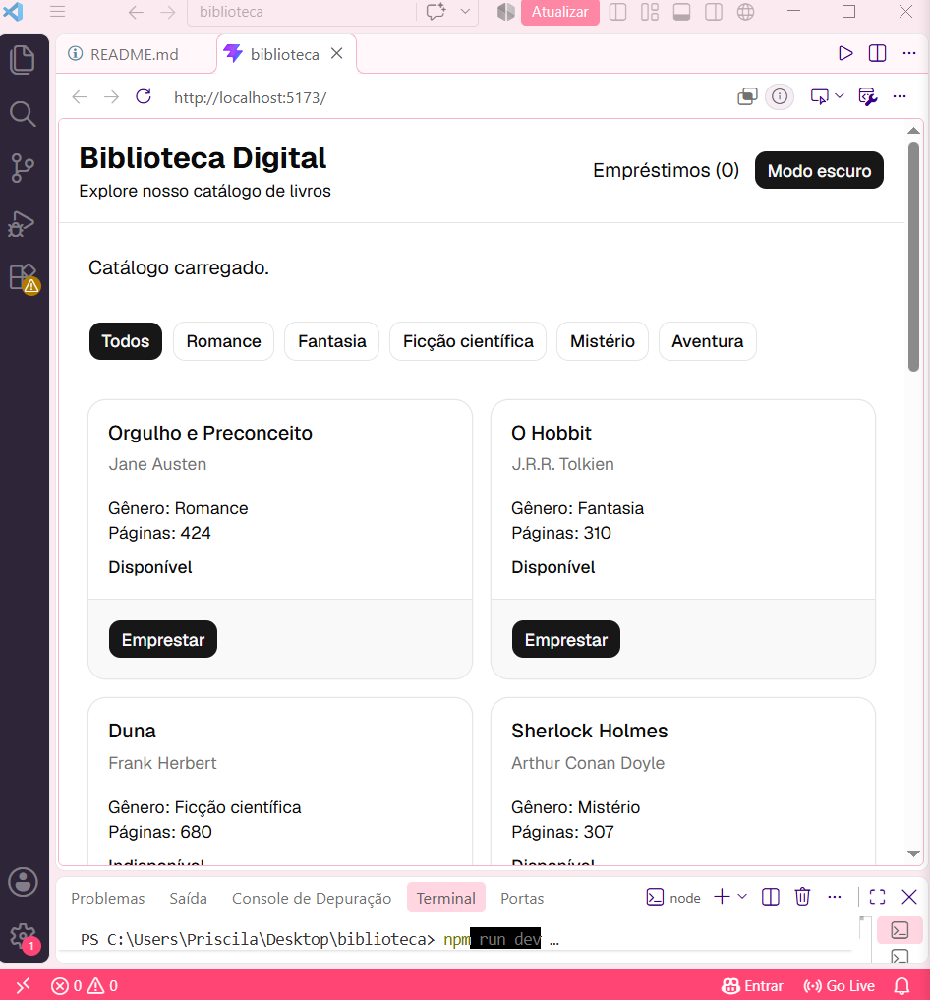
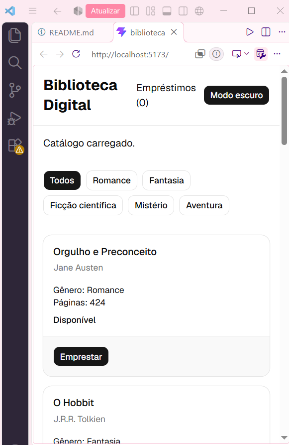
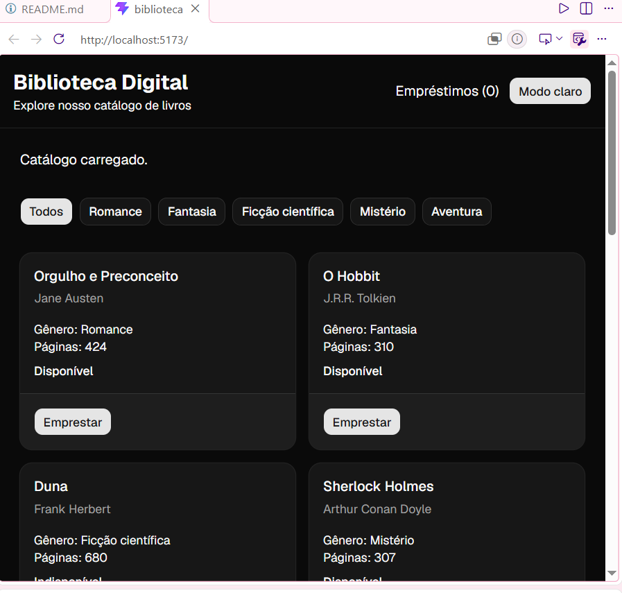

# Biblioteca Digital

Projeto desenvolvido em React 18, Vite, Tailwind CSS v4 e shadcn/ui.

## Como executar o projeto

1. Instale as dependências:

npm install

2. Inicie o servidor:

npm run dev

3. Acesse o endereço indicado no terminal.

## Funcionalidades

- Catálogo com 10 livros.
- Filtro por gênero.
- Empréstimo e devolução de livros.
- Contador de empréstimos.
- Reserva por e-mail.
- Histórico das últimas atividades.
- Modo escuro.
- Carregamento assíncrono.

## Tecnologias utilizadas

- React 18
- Vite
- JavaScript
- Tailwind CSS v4
- shadcn/ui

## Event Loop

O JavaScript executa as tarefas seguindo uma ordem:

1. **Call Stack:** executa o código síncrono primeiro.
2. **Microtask Queue:** executa Promises depois do código síncrono.
3. **Macrotask Queue:** executa setTimeout depois das microtasks.

No projeto, a Promise é executada antes do setTimeout, respeitando essa ordem.

## Diagrama Observer

```mermaid
flowchart TD
    A[App] --> B[EventBus]
    B --> C[ActivityPanel]
    C --> D[Atividades recentes]

    ## Decisões do projeto

- Os dados dos livros ficam separados no arquivo books.js.
- O estado principal fica no componente App.
- O EventBus utiliza o padrão Observer para comunicar os componentes.
- Os componentes foram separados em arquivos para facilitar a organização.
- O Tailwind CSS foi utilizado para criar o layout responsivo.

## Capturas de tela

### Versão Desktop


### Versão Mobile


### Modo Escuro
